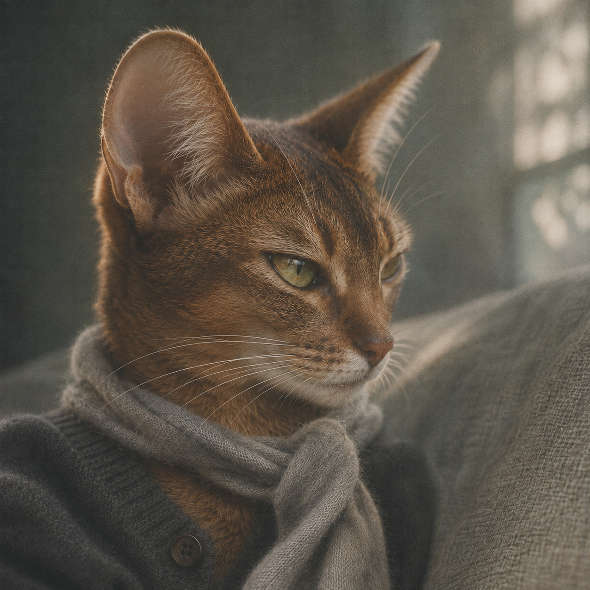
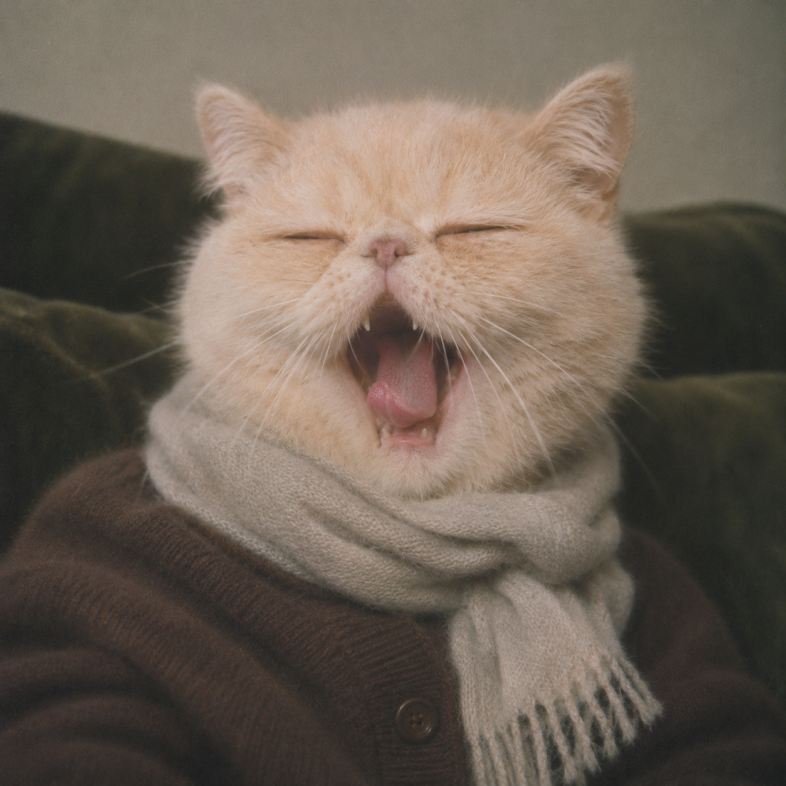
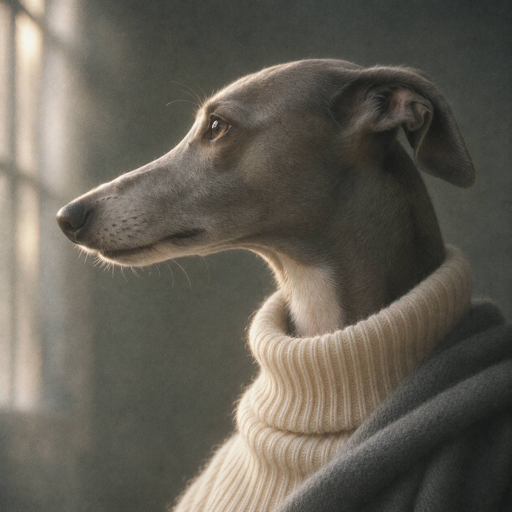
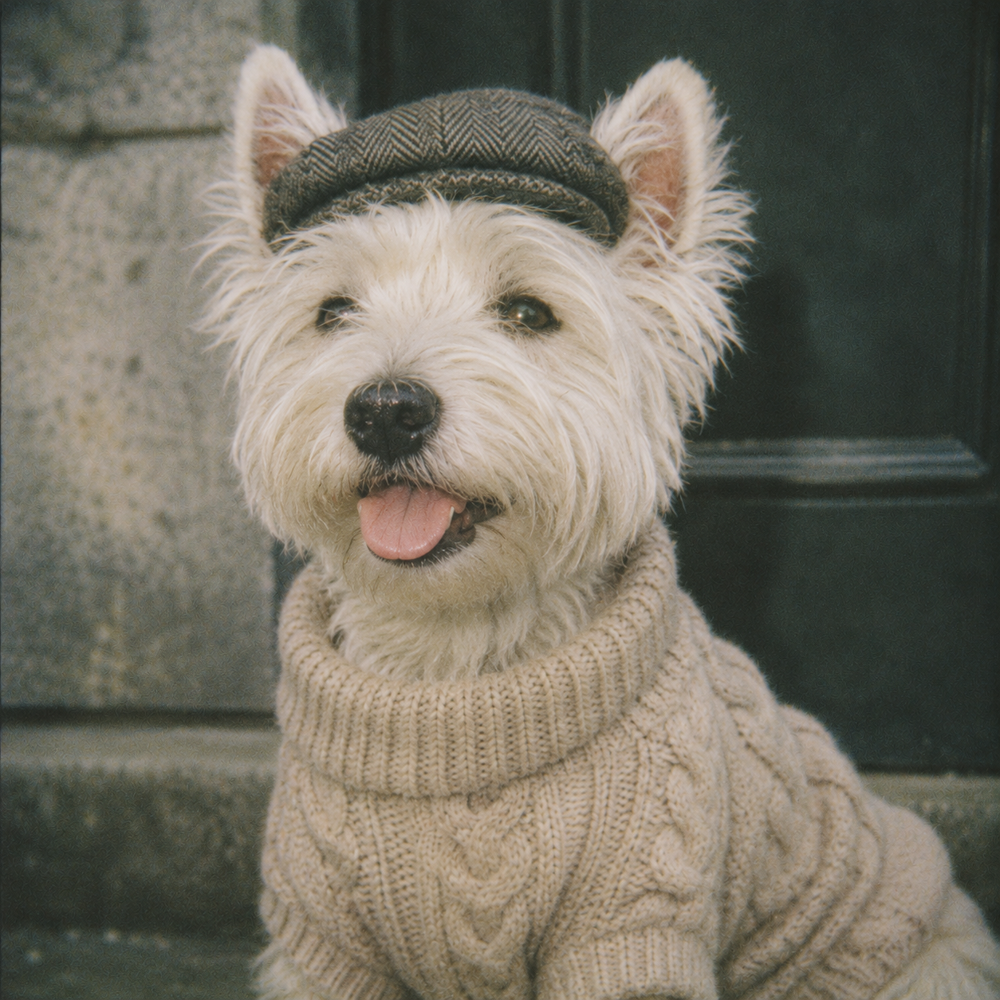

# 给小动物拍组大片 · Pet Portrait Skills

两套独立的动物肖像 Skill：**高奢胶片肖像**和 **LOMO 自然抓拍**。由赛博小熊猫 Loki 制作，包含原始 SKILL.md、摄影规则、提示词配方、照片身份约束和 8 张 AI 生成样片。

## 先看效果

| 高奢肖像 | LOMO 抓拍 |
| --- | --- |
|  |  |
|  |  |

## 选一套

- [有腔调的动物 · 高奢大片](skills/create-pet-film-portraits/SKILL.md)：贵气、慵懒、文艺的情绪，侧光、针织和电影胶片质感。
- [LOMO 萌宠 · 快乐瞬间](skills/capture-pet-lomo-moments/SKILL.md)：发懵、哈欠、吐舌、回头等自然瞬间，亲近的 lo-fi 胶片感。

猫狗之外，也可以指定其他动物。动作和服装需要适应该物种，不能机械套用猫狗表情。

## 怎么用

1. 下载本仓库（Code → Download ZIP），或使用 [Releases](../../releases/latest) 里的两份独立 Skill ZIP。
2. 在支持 Skill 导入的助手里导入相应 ZIP；本地 Skill 环境则把对应目录放入该工具的 skills 目录。请保留 references、assets 和 agents 子目录。
3. 需要具备看图和图像生成／编辑能力的工具。此仓库不包含出图模型或 API 额度，不能单独运行生图。
4. 调用你选的 Skill，说明动物、数量和风格。做自家宠物时，上传身份照片。

例子：

> 用高奢大片这套，给照片里的它做一张，穿浅色针织。保留照片里的角度和花纹，不要补没拍到的另一侧。

> 用 LOMO 快乐瞬间，创作四张不同猫狗的自然抓拍，有发懵、哈欠、吐舌和回头。

不支持 Skill 的环境可以查看两套各自的 `references/prompt-recipes.md`，复制提示词配方。个体编辑前同时阅读 `references/photo-identity.md`，不能只复制风格段落。

## 自家宠物：先保住它的样子

- 先观察可见花纹、脸型、眼耳和特殊标记，明确照片没展示的部分。
- 单侧照不自动变另一侧，头部照不凭空补全身，不用同品种标准代替个体细节。
- 需要目标角度时，针对性补图；只有一张就按这一张的可见范围继续做。
- 身份照片决定长相；样片只提供摄影风格。
- 生成后对照原照检查，不能承诺 100% 保真或像素锁定。

## 样片品种

高奢组：英国短毛猫、可卡犬、惠比特犬、阿比西尼亚猫。

LOMO 组：布偶猫、异国短毛猫（常被称为加菲猫）、西高地白梗、长毛腊肠犬。

这里记录的是生成时的品种设定，不是通过照片进行真实动物血统鉴定。

## 来源和验证状态

两套 Skill 于 2026-11-12 从作者的原始 Skill 编辑器导出。`skills/` 内容保持导出原样，未重写摄影规则；仓库说明与许可证为本次新增。

已检查文件完整性、样片可读取、相对资源引用；已展示新动物创作样片。真实宠物照片的相似度与跨模型效果仍需实测，不把规则检查当作成片效果验收。两套均保留独立资源，不互相依赖。

## 许可

[MIT](LICENSE)。样片为 AI 生成，供风格参考；请勿把它们宣称为真实摄影记录。上传自家宠物照片时，请按所用工具的隐私设置处理。
